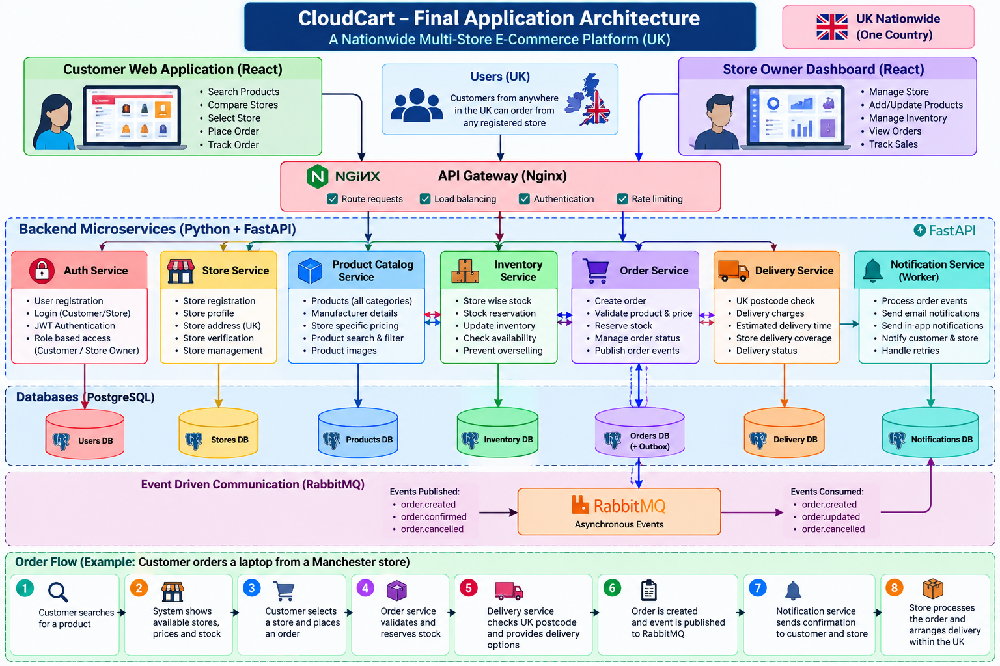

# ☁️ CloudCart — Phase 2: CODE

**A UK-wide, multi-store e-commerce web application** built with React and seven Python/FastAPI services. Customers choose which UK store to buy from; prices and stock belong to each store. This is a **learning project**, not a production storefront.

## Where we are in the DevSecOps lifecycle

- ✅ PLAN — architecture agreed and saved separately.
- ✅ CODE — this repository (React + microservices source code).
- ⏳ BUILD — Dockerfiles, image creation and Docker Compose **later, together**.
- ⏳ TEST / SECURE — expand unit and integration tests; SAST, dependency and image scanning.
- ⏳ RELEASE / DEPLOY — GitHub Actions, Terraform, AWS, Kubernetes.
- ⏳ OPERATE / MONITOR — Prometheus, Grafana, logging, alerts.

**Intentionally no Dockerfile, Docker Compose, GitHub Actions, Terraform, Kubernetes or Nginx configuration yet.**

## Architecture




```text
                    Customer React site / Seller dashboard
                                     |
                         Vite local development proxy
                                     |
          +-----------+----------+---+------+----------+----------+
          |           |          |          |          |          |
       Auth API    Stores API  Catalog API Inventory  Orders API Delivery API
          |           |          |          |          |          |
       Users DB   Stores DB  Products DB  Stock DB  Orders DB  Delivery DB
                                                        |
                                                Transactional outbox
                                                        |
                                                     RabbitMQ (optional locally)
                                                        |
                                               Notifications worker + DB
```

Every service owns its own database; shared Python utilities are **code only**, not shared tables. Each service can use PostgreSQL by setting the matching `*_DATABASE_URL`. Local coding defaults to separate SQLite files so you can learn without installing infrastructure yet. PostgreSQL and RabbitMQ will be configured and tested together in the later setup stages.

## Run locally (Windows PowerShell)

Prerequisites: Python 3.11+, Node.js 20+, npm. Open **three terminals** in the extracted project directory.

**Terminal 1 — backends**

```powershell
py -m venv .venv
.\.venv\Scripts\Activate.ps1
pip install -r requirements-dev.txt
Copy-Item .env.example .env
python scripts/run_local.py
```

**Terminal 2 — demo data** (after backends start)

```powershell
.\.venv\Scripts\Activate.ps1
python scripts/seed_demo.py
```

**Terminal 3 — frontend**

```powershell
cd frontend
npm install
npm run dev
```

Visit **http://localhost:5173**. Browse products, select a seller, sign in, place a demo order, and verify its stock decreased. Explore API docs at `http://127.0.0.1:8005/docs` (orders); other services are on ports 8001–8006.

Demo accounts (local learning only):

| Role | Email | Password |
| --- | --- | --- |
| Buyer | `demo.customer@cloudcart.local` | `DemoPassword123!` |
| Seller | `demo.owner@cloudcart.local` | `DemoPassword123!` |

## Backend services

| Service | Port | Owns |
| --- | --- | --- |
| Auth | 8001 | Registration, login, JWT, users |
| Stores | 8002 | UK store profiles, ownership |
| Catalog | 8003 | Global products and store-specific price listings |
| Inventory | 8004 | Per-store stock and atomic reservations |
| Orders | 8005 | Checkout, order history, status, event outbox |
| Delivery | 8006 | UK postcode format and fixed-rate demo delivery |
| Notifications | Worker | RabbitMQ consumer, processed-event records; does **not** send real emails |

In Phase 2, **placing an order is functional without RabbitMQ**. Each order queues a durable outbox record for subsequent event publishing. In a later stage, connect RabbitMQ and launch the publisher/worker:

```text
python -m services.orders.dispatcher
python -m services.notifications.worker
```

They require a running RabbitMQ server. The Vite development proxy temporarily routes API calls; we will implement a dedicated gateway later.

## Source structure

```text
frontend/                 React website + seller dashboard
services/auth/            Account and JWT APIs
services/stores/          Seller store profiles
services/catalog/         Products and store-specific offers
services/inventory/       Stock reservations
services/orders/          Orders + outbox publisher
services/delivery/        UK delivery quotes
services/notifications/   RabbitMQ event worker
shared/                   Shared Python helpers, not shared data
scripts/run_local.py      Launch backend APIs locally
scripts/seed_demo.py      Create 3 stores and demo products
tests/                    Starter automated tests
```

## Test locally

```powershell
pytest -q
```

## Production gaps (intentional, future work)

- **No payment processing:** checkout is a demo and cannot take real money.
- **One seller per checkout**, no multi-store cart yet.
- Delivery rates are illustrative and postcode validation does not check real addresses.
- Country-of-manufacture data is seller-provided and not verified.
- Stock release for cancelled orders uses best-effort calls; handling crashes across services needs a durable compensation/saga workflow.
- Shared development JWT secret and static internal key must be replaced by proper secrets, service identity and identity-provider design before internet exposure.
- API idempotency keys, retries/dead-letter queues, pagination, observability, migrations, rate limiting and hardened auth are upcoming DevSecOps/reliability tasks.
- No actual carrier booking or email delivery in this version.

**Goal:** learn the source code first; add DevOps components during their own lifecycle stages.
